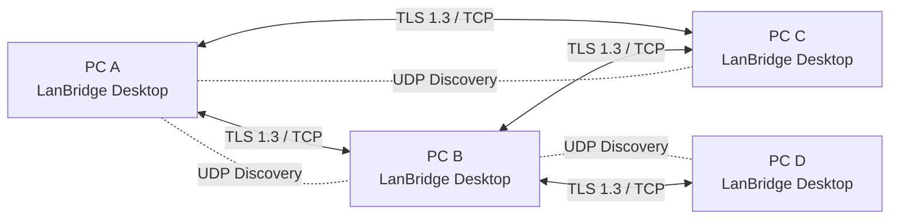

# LanBridge V1 — Implementation Plan

**Phiên bản tài liệu:** 1.0  
**Ngày:** 2026-10-29  
**Trạng thái:** Plan triển khai (chưa viết code)  
**Đối tượng:** Ứng dụng Windows dùng cá nhân trong mạng LAN, hỗ trợ nhiều PC.

---

## 0. Tóm tắt và các quyết định đã chốt

LanBridge là ứng dụng desktop chạy trên từng PC Windows, **không cần server/cloud**, trao đổi clipboard và file trực tiếp qua LAN theo mô hình P2P. Sau khi cài và tham gia nhóm, người dùng thao tác nhanh từ khay hệ thống hoặc phím tắt; không phải tạo Windows shared folder, không cấu hình IP hay firewall thủ công trong môi trường Windows cá nhân thông thường.

| Hạng mục | Quyết định |
|---|---|
| Số lượng máy | Thiết kế không giới hạn cứng theo 2 PC; mục tiêu sử dụng 2–20 PC/nhóm trong V1 |
| Clipboard | **Một clipboard dùng chung toàn nhóm**. PC bất kỳ `Ctrl+Shift+C` công bố nội dung mới; PC khác `Ctrl+Shift+V` dán nội dung mới nhất đã nhận được |
| Chuyển file | Kéo thả file vào ứng dụng → chọn **một hoặc nhiều máy**, có nút **Chọn tất cả** |
| Máy offline | Không nhận nhiệm vụ gửi file mới; nếu phiên truyền đang dở bị gián đoạn, hỗ trợ resume khi đủ điều kiện |
| Nhận file | Tự động nhận từ thiết bị được phép; lưu vào thư mục đã cấu hình, không hỏi mỗi lần |
| Thành viên | Quản lý theo nhóm; máy mới muốn tham gia phải được Admin duyệt |
| Quản trị | Hỗ trợ **nhiều Admin**; Admin duyệt/gỡ máy, cấp/thu hồi quyền; thành viên thường trao đổi dữ liệu |
| Phụ thuộc máy tạo nhóm | Không: máy tạo nhóm offline thì các máy khác vẫn dùng được; Admin khác online có thể duyệt máy mới |
| Giao diện | App WPF nhỏ gọn, System Tray, startup cùng Windows |
| Mạng | Cùng LAN, TCP/TLS 1.3 cho dữ liệu; UDP discovery; không yêu cầu Internet |
| Quyền Windows | Installer yêu cầu UAC *khi cần*, tạo firewall rule hạn chế Private/LocalSubnet; app thường chạy không cần quyền Admin |
| Bảo mật | Xác thực thiết bị trước truyền dữ liệu, TLS với khóa thiết bị đã xác thực, có thể thu hồi quyền |

### Nguyên tắc thiết kế

1. **Ưu tiên dễ sử dụng:** cấu hình một lần; copy/paste và kéo-thả là luồng chính.
2. **Không server trung tâm:** không cần một PC bật 24/7; không cần SQL Server, Redis, Docker, đăng nhập Microsoft hay cloud.
3. **Không âm thầm đánh cắp clipboard:** chỉ công bố nội dung khi người dùng nhấn hotkey; mặc định chỉ hỗ trợ text.
4. **Tự động, nhưng không bỏ qua bảo mật hệ điều hành:** yêu cầu xác nhận UAC và quyền admin hợp lệ khi tạo rule; không tắt firewall/Defender.
5. **Tương thích thực tế Windows:** xử lý hotkey trùng, ứng dụng elevated, clipboard bị khóa, Wi-Fi cô lập khách, mạng Public/GPO.

## 1. Phạm vi V1 và không làm V1

### Có trong V1

- WPF desktop Windows 10/11 x64, .NET 10 LTS, đóng gói self-contained (máy nhận không phải cài .NET runtime riêng).
- Single instance mỗi phiên đăng nhập; System Tray và autostart sau khi người dùng đăng nhập.
- UDP IPv4 discovery trong cùng broadcast domain/subnet; danh sách thiết bị online/offline và nút làm mới.
- Kết nối thủ công bằng IP làm phương án dự phòng **chỉ khi discovery thất bại** (không phải cấu hình mặc định).
- Tạo nhóm, xin gia nhập nhóm, duyệt nhóm, quảng bá trạng thái, nhiều Admin, thu hồi thành viên.
- Clipboard text Unicode có phím tắt cấu hình được; một giá trị clipboard dùng chung toàn nhóm.
- Gửi đồng thời một hoặc nhiều file cho một hoặc nhiều máy online; tiến độ theo từng máy/file; kiểm tra toàn vẹn và resume.
- Nhận file tự động vào thư mục mặc định `%USERPROFILE%\Downloads\LanBridge`, cho phép đổi vị trí.
- Thông báo Windows/toast hoặc thông báo Tray cho kết quả, nhận file, lỗi mạng.
- Installer cài all-users với UAC lúc cài nếu đủ quyền; tự thiết lập rule; uninstall gỡ các rule do mình tạo.
- Settings, nhật ký sự kiện tối thiểu, diagnostics kết nối.

### Không làm trong V1

- Gửi file cho máy offline, server relay, kết nối xuyên Internet/NAT, cloud sync, tự cập nhật qua cloud.
- Theo dõi clipboard liên tục hoặc tự động sao chép `Ctrl+C` thông thường.
- Đồng bộ ảnh clipboard, HTML/rich-text, file clipboard (dùng giao diện kéo thả cho file).
- Kéo thả nguyên folder (để V2), điều khiển chuột/bàn phím giữa máy, chia sẻ màn hình.
- File Sharing/SMB, thiết lập network drive hoặc service chạy trước khi login.
- Nhiều nhóm hoạt động đồng thời trên một client (V1 một nhóm đang hoạt động mỗi profile Windows).
- Bảo đảm kết nối trong mạng Public, guest Wi-Fi client isolation hoặc hệ thống bị Group Policy quản lý.

## 2. Kiến trúc



**Chạy một process LanBridge.exe trên mỗi Windows session**, chia các module (có thể đặt trong cùng solution):

| Module | Trách nhiệm |
|---|---|
| `LanBridge.Desktop` | WPF View, ViewModel, tray, notification, drag/drop |
| `LanBridge.Core` | Domain models, trạng thái thiết bị, group policy, trạng thái truyền |
| `LanBridge.Windows` | RegisterHotKey, Clipboard, SendInput, startup, Windows integration |
| `LanBridge.Network` | UDP discovery, TCP listener/client, TLS, heartbeat, reconnect, protocol |
| `LanBridge.Security` | Device identity, join/approve, admin signatures, membership validation, revoke, DPAPI |
| `LanBridge.Clipboard` | Local capture, group broadcast, conflict ordering, local paste |
| `LanBridge.Transfer` | Offer/accept tự động, chunk stream, SHA-256, resume, cancel |
| `LanBridge.Storage` | SQLite (metadata), JSON settings, encrypted local keys, file checkpoints |
| `LanBridge.Installer` | Setup, firewall setup/repair/remove, uninstall |
| `LanBridge.Tests` | Unit, integration, protocol, security, UI/system tests |

**Persistence:** JSON cho settings; SQLite embedded cho device/group/events/transfer metadata, không cần DB server. Bí mật/khóa cá nhân được bảo vệ bằng Windows DPAPI cho Windows user hiện hành; plaintext clipboard chỉ giữ trong RAM.

## 3. Mạng, discovery và kết nối

### 3.1. Port V1 (có thể đổi trước release nếu xung đột)

| Protocol | Port | Dùng cho |
|---|---|---|
| UDP | 47322 | LAN discovery: announce + probe, không có dữ liệu clipboard/file hoặc bí mật |
| TCP | 47321 | Kênh đã xác thực để truyền control messages, clipboard, file chunks |

- Chỉ lắng nghe interface LAN phù hợp, không tự kết nối ra Internet; bỏ qua VPN/virtual adapter không phù hợp khi discovery.
- UDP broadcast trong phạm vi subnet, beacon có `protocolVersion`, `deviceId`, `deviceDisplayName` (nếu được phép), `listeningPort`, nonce, **không chứa group secret**. Có rate limit và giới hạn kích thước message.
- Peer phát hiện qua UDP thì mở TLS/TCP; **không coi discovery là xác thực**.
- Keepalive/heartbeat: ví dụ 10 giây; mất 3 lần xác định offline (giá trị cấu hình trong code).
- Mất mạng: reconnect với exponential backoff + jitter; đổi IP tìm lại bằng `deviceId` + fingerprint, không gắn định danh với IP.
- Nếu broadcast bị chặn, có chức năng nhập IP/hostname làm đường dự phòng; nếu AP có client isolation thì TCP giữa hai máy vẫn có thể không hoạt động.
- Một kết nối bảo mật có thể multiplex các message loại clipboard, group sync, transfer control; truyền file streaming qua chính TCP/TLS với mức ưu tiên control để tránh kẹt giao diện.
- Với 20 PC: duy trì kết nối đến peer trực tiếp khi cần; tránh discovery storm, heartbeat dồn, nhiều kết nối trùng; duplicate connection giải quyết theo thứ tự `deviceId` để một peer-pair giữ một phiên logic.

### 3.2. Protocol nội bộ

- Messages có `protocolVersion`, `messageType`, `messageId`, `senderDeviceId`, `groupId`, `timestamp`, `requestId`, `payloadLength`.
- Dùng JSON độ dài giới hạn cho control messages; binary framed chunks cho file; đặt giới hạn payload, timeout, kiểm tra schema; không dùng BinaryFormatter hoặc deserialize class tùy ý từ mạng.
- Idempotency: `messageId`, `transferId`, event IDs; xử lý trùng không lặp trạng thái.
- Có version negotiation và từ chối rõ ràng client không tương thích; không tự động downgrade bảo mật.
- TLS 1.3 + thiết bị có keypair riêng; xác nhận fingerprint/khóa thiết bị khi ghép cặp; mọi reconnect phải kiểm tra danh sách thành viên còn hiệu lực.

## 4. Quản lý nhóm, nhiều Admin và bảo mật

### 4.1. Identity

- Khi chạy lần đầu, mỗi **Windows user profile** sinh một `deviceId` ngẫu nhiên và bộ khóa định danh riêng; tên Windows chỉ là thông tin hiển thị, không phải định danh an toàn.
- Khóa riêng lưu cục bộ dưới DPAPI, không đồng bộ ra máy khác, không xuất plaintext vào log.
- Một nhóm có `groupId` ngẫu nhiên, danh sách thành viên tin cậy, role và quyền.
- Trên màn hình có thể hiển thị `PC name`, `role`, `online/offline`, lần nhìn thấy gần nhất và nút revoke.

### 4.2. Tạo nhóm và xin gia nhập

1. PC A tạo nhóm: tự có role `Admin`.
2. PC B phát hiện nhóm, chọn **Tham gia**.
3. Một Admin đang online nhận yêu cầu; hai bên kiểm tra cùng mã ghép cặp ngắn (SAS) và Admin nhấn **Duyệt**.
4. Sau khi xác thực, Admin ký sự kiện thêm thành viên và gửi chứng thực membership; đồng bộ sự kiện với các thiết bị khác trong nhóm.
5. B nhận được danh sách thành viên và bắt đầu trao đổi trực tiếp; không cần PC A tiếp tục online.
6. Có thể nâng B thành Admin. Các Admin được cấp quyền duyệt thiết bị khác.

### 4.3. Đồng bộ danh sách nhóm trong mô hình không server

Đây là phần **bắt buộc thiết kế cẩn thận** trước khi code các tính năng UI:

- Dùng **append-only membership event log** cục bộ: `MemberJoined`, `RoleChanged`, `PermissionChanged`, `MemberRevoked`; event chứa ID duy nhất, `groupId`, tác giả Admin, lamport/logical sequence, subject device, chữ ký số.
- Peer chỉ chấp nhận event được ký bởi một Admin có quyền **tại thời điểm phát hành hợp lệ** theo lịch sử membership; kiểm tra replay/conflict và version.
- Các máy online gossip/sync events đã biết, idempotent, lưu lại; máy offline nhận bù khi quay lại.
- Xung đột giữa Admin: quy tắc deterministic, **revoke ưu tiên grant đồng thời**; thiết bị bị thu hồi muốn vào lại phải có phiên tham gia mới được xác thực và cấp key/membership mới.
- Không thể bỏ quyền của Admin cuối cùng; nếu Admin nào cũng offline, thành viên đã duyệt vẫn trao đổi được nhưng không duyệt máy mới cho đến khi có Admin online.
- Những thay đổi quan trọng đều có audit tối thiểu `who / action / device / time` (không lưu nội dung clipboard).
- Một mạng P2P bị phân vùng không bảo đảm thu hồi quyền **ngay lập tức trên mọi máy đang offline**. UI phải nêu trạng thái phát tán/thiết bị chưa đồng bộ; peer áp dụng revoke và chặn kết nối mới ngay sau khi nhận cập nhật. Đây là giới hạn thực tế của thiết kế không có server đồng bộ trung tâm.
- Không dựa hoàn toàn vào thời gian đồng hồ các PC để quyết định quyền. Security event validation cần test độc lập và fail closed với trạng thái chưa xác minh.

### 4.4. Quyền

| Hành động | Admin | Member |
|---|---:|---:|
| Đọc/gửi clipboard chung | Có | Có |
| Gửi/nhận file | Có | Có |
| Duyệt máy mới | Có | Không |
| Xóa/thu hồi máy | Có | Không |
| Nâng/hạ role | Có (không bỏ Admin cuối) | Không |
| Đổi thư mục nhận và hotkey của chính máy | Có | Có |
| Xem log của máy khác | Không (V1) | Không |

Mỗi request phải kiểm tra `groupId` và membership/permission thực tế của peer, **không dựa vào nút UI ẩn/hiện**.

## 5. Clipboard chung

### 5.1. Hành vi người dùng

1. Trên PC A, người dùng chọn text trong ứng dụng.
2. Nhấn `Ctrl+Shift+C` (hotkey toàn hệ thống đăng ký bằng `RegisterHotKey`).
3. LanBridge gửi tổ hợp `Ctrl+C` đến ứng dụng đang có focus, đợi clipboard cập nhật và lấy `UnicodeText`.
4. Gói clipboard mới được phát cho các thành viên online trong nhóm qua các phiên đã xác thực, đồng thời lưu trong RAM của A.
5. PC B/C/D nhận event và lưu **bản mới nhất trong RAM của LanBridge**; *không tự ghi đè Clipboard Windows*.
6. Trên PC B, nhấn `Ctrl+Shift+V`; LanBridge ghi text vào Clipboard Windows của B, sau đó gửi `Ctrl+V` vào ứng dụng đang focus.
7. Trạng thái lần dán trên B **không** tự phát tán thành sự kiện clipboard mới, tránh vòng lặp.

### 5.2. Các điểm kỹ thuật quan trọng

- Đăng ký hotkey bằng `RegisterHotKey(..., MOD_NOREPEAT)`; nếu bị trùng phải báo và cho đổi, không ép dùng low-level keyboard hook.
- Clipboard WPF truy cập trên STA thread; xử lý clipboard busy/lock bằng backoff ngắn có giới hạn.
- Khi copy: ghi nhận `GetClipboardSequenceNumber()` trước, gửi Ctrl+C rồi chờ clipboard thay đổi; nếu ứng dụng không hỗ trợ hoặc không thể lấy text → báo lỗi, **không gửi dữ liệu cũ nhầm**.
- Đợi các modifier (Ctrl/Shift) được thả trước khi mô phỏng `Ctrl+V`; nếu không có thể tạo tổ hợp không mong muốn.
- `SendInput` bị Windows UIPI giới hạn: app thường không điều khiển được cửa sổ chạy quyền Administrator. UI nêu hạn chế, không chạy toàn ứng dụng elevated để vượt cơ chế bảo vệ.
- Nội dung v1: Unicode text/plain, giữ dòng, URL, UTF-8 khi gửi; mặc định chặn payload trên **2 MiB** và báo lý do. Không gửi ảnh hoặc file qua clipboard.
- Cập nhật toàn nhóm: mỗi sự kiện có `clipboardEventId`, `originDeviceId`, logical timestamp (Lamport + tie breaker theo device ID). Peer bỏ qua update cũ/trùng; hai máy copy gần đồng thời có thứ tự cuối cùng **nhất quán sau khi đồng bộ**, không cam kết đo thứ tự tuyệt đối theo giờ thực.
- Chỉ giữ **mục clipboard chung mới nhất trong RAM**, không lưu plaintext vào SQLite/log; mặc định hết hạn sau 30 phút kể từ lần publish (có thể cấu hình). Khi kết nối lại, sync bản mới nhất còn hạn cho thành viên đã tin cậy, không phục hồi nội dung quá hạn.
- Có tùy chọn tắt Clipboard Sharing trên máy cục bộ; nút `Clear shared clipboard` gửi lệnh xóa đã xác thực đến nhóm (xử lý như một event mới).
- Nếu chưa có nội dung shared hợp lệ, `Ctrl+Shift+V` không làm gì ngoài thông báo ngắn; không ghi clipboard rỗng lên máy người dùng.

### 5.3. Test Clipboard

- Text tiếng Việt, emoji, nhiều dòng, khoảng trắng đầu/cuối, URL dài.
- A→B, B→A, A→C sau khi B reconnect.
- Copy trùng nội dung liên tiếp, không chọn text, clipboard bị app khác chiếm.
- Hai PC copy cùng thời điểm; state convergence, không phát vòng lặp.
- Hotkey conflict, reset sau restart, ứng dụng elevated/UAC focus.
- Copy lớn quá hạn mức; không leak text vào disk hay log.

## 6. Truyền file

### 6.1. Gửi file

1. PC A mở Home hoặc cửa sổ Send; kéo một/nhiều file vào vùng Drop.
2. UI hiển thị file names/sizes và danh sách **máy online thuộc nhóm**.
3. Tích một/multiple PC hoặc nút **Chọn tất cả** (chỉ những máy online có quyền nhận).
4. Nhấn **Gửi**. Mỗi máy nhận có phiên/trạng thái riêng; gửi đến B thành công không bị ảnh hưởng nếu C lỗi.
5. Máy nhận kiểm tra xác thực membership, quyền gửi, dung lượng trống và path, sau đó **tự lưu** vào thư mục đã cấu hình.
6. Khi tất cả chunk và SHA-256 khớp, đổi file `.part` sang tên chính thức, hiển thị notification; có nút mở file/mở folder.

### 6.2. Kỹ thuật truyền

- Control handshake: `FileOffer` → `FileAccept/Reject` → `FileChunk` (stream) → `TransferComplete` → `VerifyComplete`.
- Đọc/ghi `FileStream` theo từng chunk (ví dụ 1 MiB), không nạp cả file vào RAM.
- `transferId` duy nhất; track file identity, filename, original size, mtime, total hash; checkpoint offset và nhận đã xác nhận.
- Resume: khi bị mất mạng giữa chừng, chỉ resume **phiên truyền đã có** nếu sender online, file nguồn vẫn tồn tại và chưa thay đổi; receiver giữ `.part`. Không tạo nhiệm vụ gửi mới cho máy đang offline.
- Kiểm tra hash toàn file SHA-256 trước khi đánh dấu thành công. Nếu khác checksum, không công khai file hỏng cho user.
- Trùng tên → `name (1).ext`, `name (2).ext`; tên file sanitize, chặn `..`, dấu phân cách đường dẫn và viết ra ngoài folder đích. Không thực thi file sau khi nhận.
- Kiểm tra đủ dung lượng trống, quyền ghi, tên file bất hợp lệ, lock file, antivirus quarantine, file nguồn bị thay đổi.
- Giới hạn concurrency mặc định: **2 file transfers gửi / PC**, **2 nhận / PC**; các đích khác được xếp hàng **chỉ khi đã bắt đầu yêu cầu tới máy online**. Có cancel, progress, tốc độ, ETA ước tính trong UI (không cần đo tuyệt đối).
- Receiver kiểm tra path và allowlist tên; không cho sender gửi đường dẫn tùy ý trên máy đích. Thư mục nhận mặc định `%USERPROFILE%\Downloads\LanBridge`.
- Dọn `.part`/checkpoint quá hạn theo chính sách (ví dụ sau 24 giờ) khi không có phiên hợp lệ; không xóa file người dùng khác.
- Rate limit nhận/gửi và giới hạn số offer đồng thời để tránh lạm dụng/đầy ổ cứng, kể cả peer đã là thành viên.

### 6.3. Trạng thái

`Created → Offering → Accepted → Transferring → Verifying → Completed`

Nhánh lỗi: `Rejected`, `Failed`, `Canceled`, `Interrupted` → `Resuming` nếu hợp lệ.

### 6.4. Test File

- Nhiều file nhỏ, một file vài GB (ví dụ 5 GB), Unicode filename, tên rất dài.
- A gửi tới B/C/D, một máy hết ổ, máy khác vẫn hoàn tất.
- Mất Wi-Fi giữa file và reconnect, không gửi trùng/không hỏng file.
- Thử file trùng tên, không có quyền ghi, file nguồn thay đổi trong lúc gửi.
- Malware/EXE: nhận dưới dạng file nhưng **không tự chạy**.
- Chặn path traversal, message kích thước sai, hash giả, thiếu chunk.

## 7. Quyền Windows, installer và firewall

### 7.1. Quy tắc

- **Installer** yêu cầu UAC Admin khi cần cài vào Program Files và tạo rule; app thực tế chạy bằng quyền user thường.
- Không tắt Windows Firewall/Defender, không đổi chính sách mạng máy người dùng, không yêu cầu bật File and Printer Sharing.
- Tạo firewall inbound rules riêng cho app (TCP 47321, UDP 47322), `Profile=Private`, `RemoteAddress=LocalSubnet`, `Program=<đường dẫn exe>`.
- Chỉ thao tác các rule mang ID/tag riêng của LanBridge; installer upgrade sửa đúng đường dẫn mới và uninstall xóa đúng rule.
- Sau cài, **kiểm tra** rule tồn tại, có hiệu lực, profile mạng phù hợp và thử kết nối; nếu thất bại, Diagnostics hiển thị nguyên nhân/giải pháp. Cơ chế Repair Firewall có thể yêu cầu lại UAC.
- Nếu Windows đang là Public network hoặc Group Policy/antivirus chặn rule, **không cam kết zero-click**; hướng dẫn người dùng hoặc liên hệ quản trị IT (nếu máy công ty).
- Không cần administrator để đăng ký hotkey hay đọc clipboard của ứng dụng thông thường trong cùng user session.

### 7.2. Cài đặt và cập nhật

- Installer dùng **WiX Toolset (MSI/bundle)** hoặc Inno Setup (chọn một trong implementation, ưu tiên WiX nếu hệ sinh thái .NET thuần); packaging self-contained `win-x64`.
- File cài đặt có version, icon, uninstaller, uninstall cleanup, startup registry/user task tại logon.
- Upgrade in-place giữ `groupId/deviceId` và khóa riêng người dùng, không tự rejoin nếu vẫn tin cậy.
- Không tự động tải bản cập nhật qua Internet trong V1; nâng cấp bằng chạy installer phiên bản mới.
- Khuyến nghị ký code signing để giảm cảnh báo SmartScreen khi phát hành; UAC/SmartScreen là bước bảo vệ của Windows, không có cách hợp lệ bảo đảm chúng không xuất hiện.
- App không hoạt động khi Windows đã **log out**, session lock có thể giới hạn mô phỏng phím; khi PC ngủ/tắt thì offline. Đây không phải Windows Service.

## 8. Thiết kế UX tối giản

### 8.1. Home

```text
┌─────────────────────────────────────────────────────────────────┐
│ LanBridge                            Group: Home LAN  ● Online │
├─────────────────────────────────────────────────────────────────┤
│ Clipboard chung:  Có nội dung text mới từ PC A  [Xóa]          │
│ Tip: Ctrl+Shift+C để chia sẻ | Ctrl+Shift+V để dán              │
├─────────────────────────────────────────────────────────────────┤
│                                                                 │
│                 [Kéo thả file vào đây để gửi]                    │
│                                                                 │
├─────────────────────────────────────────────────────────────────┤
│ Máy nhận: [✓] PC B  [✓] PC C  [ ] PC D offline  [Chọn tất cả] │
│                                                     [Gửi]       │
├─────────────────────────────────────────────────────────────────┤
│ Gần đây: report.pdf     Đã gửi B, C       [Mở thư mục]          │
└─────────────────────────────────────────────────────────────────┘
```

### 8.2. Devices

- Danh sách các PC với online/offline, role Admin/Member, IP chỉ hiển thị trong detail/diagnostics.
- Nút `Thêm máy` / `Tham gia nhóm` / `Duyệt yêu cầu` (Admin).
- Cho phép promote/demote Admin, revoke/kick máy; xác nhận trước khi revoke.

### 8.3. Settings

- Hotkeys Copy / Paste; thay đổi và kiểm tra conflict tức thì.
- Folder lưu file, mở folder; bật autostart; bật/tắt clipboard sharing cục bộ.
- Thông báo, giới hạn file concurrency cơ bản (các tùy chọn nâng cao ẩn).
- Diagnostics: network profile, local port, firewall state, discovery state, last errors, device identity fingerprint.
- Không hiện màn hình cấu hình server, port, database hay chứng chỉ cho người dùng phổ thông.

### 8.4. System Tray

- Icon thay trạng thái: Connected / Disconnected / Transfer ongoing.
- Context menu: Mở LanBridge, Máy đang online, Tạm dừng chia sẻ, Mở thư mục nhận, Thoát.
- Toast khi nhận xong file hoặc có yêu cầu tham gia nhóm (Admin).

## 9. Data model cục bộ (đề xuất)

Dùng SQLite embedded với migrations; không lưu binary file hay clipboard plaintext vào DB.

| Bảng | Cột chính | Mục đích |
|---|---|---|
| `DeviceIdentity` | `deviceId`, `publicKey`, `createdAt`, `keyRef` | Định danh cục bộ, keyRef trỏ đến khóa được DPAPI bảo vệ |
| `Groups` | `groupId`, `name`, `createdAt`, `settings` | Thông tin nhóm hiện tại |
| `Members` | `groupId`, `deviceId`, `role`, `status`, `publicKey`, `lastSeenAt` | Cache trạng thái hiện tại |
| `MembershipEvents` | `eventId`, `groupId`, `actorDeviceId`, `subjectDeviceId`, `eventType`, `logicalOrder`, `signature`, `payload` | Sổ sự kiện phân tán phục vụ sync và audit |
| `Transfers` | `transferId`, `peerId`, `direction`, `fileName`, `fileSize`, `hash`, `status`, `offset`, `updatedAt` | Checkpoints/metadata cho file transfer |
| `TransferItems` | `transferId`, `itemId`, `pathRef`, `size`, `hash`, `offset`, `status` | Một phiên có nhiều file, nhiều đích |

Settings có thể dùng `%LOCALAPPDATA%\LanBridge\settings.json` (không lưu secret); DB tại `%LOCALAPPDATA%\LanBridge\lanbridge.db`; secret được DPAPI encrypt trong profile người dùng. Lưu ý mọi `pathRef` trong DB thuộc máy cục bộ, không lấy path do peer gởi làm đường dẫn tuyệt đối.

## 10. NFR: chất lượng, hiệu năng và an toàn

- Chạy ổn định trong một LAN có 2–20 PC, mỗi máy có thể gửi/nhận trong cùng nhóm; test ít nhất với 2, 5, 10 và mô phỏng 20 thiết bị.
- UI phản hồi nhanh, mọi I/O mạng/file bất đồng bộ, không block UI thread.
- Startup mục tiêu vài giây trên PC phổ thông; RAM nhàn rỗi mục tiêu dưới ~200 MB (đo thực nghiệm, không phải bảo đảm trên mọi PC).
- Trên LAN ổn định, broadcast clipboard text nhỏ mục tiêu phản hồi trong ~1 giây; kết quả phụ thuộc kết nối và Windows focus.
- Transfer streaming theo chunk, không tăng RAM tuyến tính theo kích thước file.
- Retry có backoff, không CPU busy loop, cancel được, khởi động lại không mất file hoàn tất.
- Không log nội dung clipboard, khóa bí mật, binary file; log có rotation/retention.
- Truyền dữ liệu chỉ sau khi xác thực thiết bị, không dùng HTTP plaintext; từ chối bản tin sai phiên bản/quá lớn/không hợp lệ.
- Không gửi clipboard nếu PC chưa có session được xác thực; hiện lỗi nếu tất cả peer offline.

## 11. Lộ trình implement và acceptance gates

### Phase 0 — Nền tảng solution và build

- [ ] Tạo solution .NET 10, WPF MVVM, dependency injection/logging/config.
- [ ] Tách các project/namespace theo Module §2; nullable enabled, analyzers.
- [ ] Single-instance, System Tray, autostart, lifecycle hooks, SQLite migration.
- [ ] Build self-contained win-x64; unit test base; CI build/package.

**Gate:** mở/đóng app không lỗi; tự chạy sau Windows login; không tự cần UAC.

### Phase 1 — Discovery + phiên TLS

- [ ] Device identity/key creation + DPAPI; fingerprint.
- [ ] UDP discovery + danh sách online/offline; reconnect khi đổi IP.
- [ ] TCP listener/client + TLS 1.3, pin peer identity, heartbeat, framed message protocol.
- [ ] Nếu discovery thất bại: manual connect by IP trong Advanced.
- [ ] Test fake peers/malformed input; bảo đảm no unauthenticated data exchange.

**Gate:** 2–5 PC thật tự nhận nhau trong Private LAN, TLS established, reconnect tự động.

### Phase 2 — Nhóm và nhiều Admin

- [ ] Create group/join request, SAS verification, approve/reject.
- [ ] Group membership signed events, sync/gossip/merge/idempotency.
- [ ] Admin/member roles, multi-admin approve, admin promote/demote, revoke.
- [ ] Authorization kiểm tra ở mọi network endpoint/message handler.
- [ ] Test offline owner, concurrent approvals, revocation stale peer, last admin.

**Gate:** tắt PC tạo nhóm vẫn dùng nhóm; Admin khác duyệt máy mới; revoked PC không vào được sau khi các peer nhận event thu hồi.

### Phase 3 — Clipboard toàn nhóm

- [ ] RegisterHotKey + tùy chỉnh + conflict reporting.
- [ ] `Ctrl+Shift+C` → copy selected text → detect actual clipboard update → publish.
- [ ] Lamport ordered latest event, dedupe, expiring in-memory shared clipboard.
- [ ] `Ctrl+Shift+V` → copy shared item to Windows clipboard → paste at focus.
- [ ] Test Unicode, Win32/WPF/Edge/Chrome/Word/Notepad, UIPI, busy clipboard.

**Gate:** A copy, B/C paste; B copy, A/C paste; không loop, không dùng nhầm clipboard cũ.

### Phase 4 — File Transfer nhiều đích

- [ ] Drag/drop, multi-file, chọn online recipients, Select All, Gửi.
- [ ] File offer/accept, streaming, progress per recipient, SHA-256.
- [ ] Auto-save, sanitize, duplicate name, disk space, cancellation.
- [ ] Resume interrupted session, cleanup temp file policy.
- [ ] Test multi-GB, multi-target, disconnect, invalid filename, path traversal.

**Gate:** một PC gửi nhiều file cho 2–5 PC, mọi đích nhận đúng checksum; một PC lỗi không làm hỏng gửi tới máy khác.

### Phase 5 — Installer, firewall, UX và release

- [ ] Installer self-contained x64; UAC và firewall automation Private/LocalSubnet.
- [ ] Status/error diagnostics; Repair Firewall elevated khi cần.
- [ ] Settings/Devices/Home/Toast/Tray, cấu hình nhận file và hotkey.
- [ ] Uninstall cleanup do app tạo, upgrade giữ membership/keys.
- [ ] End-to-end test với Windows 10/11, restart/login/uninstall/upgrade.
- [ ] Security review, performance soak, memory/handles/leaks, release notes.

**Gate:** người dùng chỉ cần cài → xác nhận quyền Windows → tạo/duyệt nhóm → copy/paste và kéo thả sử dụng bình thường, không tự chỉnh firewall/share.

## 12. Checklist test UAT bắt buộc

### Thiết lập và mạng

- [ ] 2 PC chung Wi-Fi Private; tự discover và join.
- [ ] 5 PC, tối thiểu 2 Admin; PC tạo nhóm tắt, phần còn lại hoạt động.
- [ ] IP DHCP đổi, reconnect thành công.
- [ ] Windows Firewall bật, **không thao tác rule thủ công** trên máy cá nhân đủ quyền.
- [ ] Windows Public network: app cảnh báo/diagnostics; không thay đổi profile trái phép.
- [ ] Guest Wi-Fi client isolation: lỗi được trình bày rõ, không nói kết nối thành công giả.
- [ ] Tắt LAN, ngủ/thức máy; offline/online đúng.

### Clipboard

- [ ] Text tiếng Việt, emoji, multiline, URL.
- [ ] Nhiều PC nhận chung nội dung, phát hiện bản mới nhất khi đồng bộ.
- [ ] Không có văn bản chọn/không thể copy: không phát nội dung cũ.
- [ ] Không có clipboard mới hợp lệ: Paste hotkey chỉ thông báo, không xóa clipboard cũ.
- [ ] Không gửi tự động khi người dùng chỉ nhấn Ctrl+C thông thường.
- [ ] Hotkey bị chiếm, clipboard lock, elevated window: lỗi rõ ràng.

### File

- [ ] A gửi nhiều file cho B/C cùng lúc; nút Chọn tất cả chỉ chọn máy online.
- [ ] D offline không nhận task mới.
- [ ] Một đích hỏng do đầy ổ, các đích khác vẫn hoàn thành.
- [ ] Mất mạng giữa file rồi resume, hash khớp.
- [ ] File có tên trùng, Unicode, lớn, file nguồn bị thay đổi.
- [ ] File không chạy tự động sau nhận; path traversal bị chặn.

### Security và quản trị

- [ ] Máy lạ không thể nhận nội dung file/clipboard bằng việc giả UDP beacon.
- [ ] Không thể giả Admin, tự duyệt, replay approval, dùng key bị revoke.
- [ ] Sau khi revoke đã được đồng bộ, client bị xóa không kết nối lại được.
- [ ] Không ghi clipboard content/secrets ra SQLite, settings, plaintext logs.
- [ ] Upgrade không mất trust; uninstall chỉ xóa rule của app.

## 13. Rủi ro và hướng xử lý

| Rủi ro | Phương án |
|---|---|
| Hotkey `Ctrl+Shift+C/V` đã bị ứng dụng khác chiếm | Kiểm tra RegisterHotKey; cho đổi từ Settings, thông báo rõ |
| `SendInput` không thể điều khiển ứng dụng chạy elevated | Thông báo hạn chế của UIPI; không tự nâng quyền toàn bộ app |
| Firewall bị GPO/antivirus/Windows Public chặn | Diagnostics + repair UAC nếu được; không tắt firewall/không né policy |
| Không có server → revoke trên PC offline bị trễ | Signed membership event gossip; công bố limitation của eventual consistency; fail closed khi thiếu trust |
| Hai Admin cập nhật gần đồng thời | Deterministic merge, idempotent log, revoke thắng khi đồng thời; unit/integration tests bắt buộc |
| Clipboard chứa bí mật | Chỉ gửi bằng hotkey, RAM only, TTL, nút Clear; không tự clipboard sync |
| PC nguồn thay đổi file khi đang truyền | Kiểm tra size/mtime và hash, hủy/resume lại khi file thay đổi |
| LAN nhiều máy tạo nhiều socket | Peer connection dedup, bounded concurrency, heartbeat có jitter, stress test |

## 14. Đầu ra yêu cầu khi giao AI coding agent

1. Source code đầy đủ, solution build được trên Windows x64.
2. README setup/build/run, cấu trúc solution, sơ đồ luồng kết nối.
3. Database migration và config defaults có version; bản ghi cục bộ không chứa clipboard plaintext.
4. Bộ unit/integration tests + kết quả chạy; checklist manual UAT cho 2/5/10 máy.
5. Installer MSI/setup tự xử lý firewall nếu được cấp quyền; uninstall/upgrade được test.
6. Không stub/hardcode bảo mật cho bản release; không claim tính năng đã xong khi chưa test trên Windows thật.
7. Mỗi phase phải pass gate mới bắt đầu phụ thuộc vào phase tiếp theo.

### Definition of Done cho V1

**V1 được xem là hoàn tất** khi 2–5 PC Windows thật cài và ghép nhóm được; nhiều Admin hoạt động; toàn nhóm copy/paste text hai chiều qua hotkey; file kéo thả gửi nhiều đích online và tự lưu; restart/reconnect hoạt động; không cần share folder/firewall thủ công trong môi trường đủ quyền; kiểm tra lỗi bảo mật/đứt mạng/khả năng resume/kiểm tra hash đều pass.

---

## Nguồn kỹ thuật Microsoft tham chiếu

- [.NET support policy](https://dotnet.microsoft.com/en-us/platform/support/policy)
- [RegisterHotKey — Win32](https://learn.microsoft.com/en-us/windows/win32/api/winuser/nf-winuser-registerhotkey)
- [SendInput / UIPI — Win32](https://learn.microsoft.com/en-us/windows/win32/api/winuser/nf-winuser-sendinput)
- [GetClipboardSequenceNumber — Win32](https://learn.microsoft.com/en-us/windows/win32/api/winuser/nf-winuser-getclipboardsequencenumber)
- [Clipboard.SetText — WPF](https://learn.microsoft.com/en-us/dotnet/api/system.windows.clipboard.settext?view=windowsdesktop-10.0)
- [New-NetFirewallRule — Microsoft PowerShell](https://learn.microsoft.com/en-us/powershell/module/netsecurity/new-netfirewallrule?view=windowsdefender)